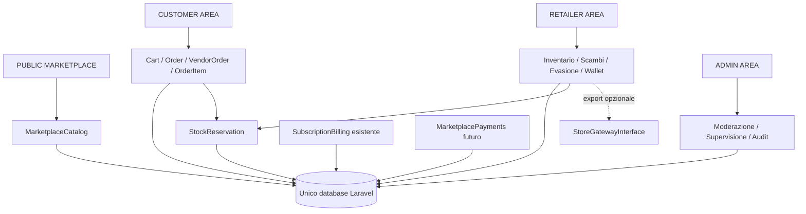

# Architettura — audit e marketplace pianificato

## EXISTING — adapter Connect e bonus separato

`StripeConnectMarketplaceGateway` implementa contratti marketplace e conguaglio con client/configurazione distinti dal billing. `ReceiveMarketplaceStripeEvent` verifica la firma e normalizza nel dominio stock/ledger esistente. `CustomerPromotionalBonus` registra grant, prenotazione, spesa, release e ripristino in un ledger indipendente dal wallet retailer. `RefundMarketplaceVendor` separa intent PSP e finalizzazione transazionale; `ReconcileMarketplacePayments` gestisce retry e incassi tardivi. Provider disabilitato per default; rilascio credito reale/payout ancora bloccato. Limiti operativi in [marketplace-payments.md](marketplace-payments.md).

> Stato corrente: decisioni PDF v1.0 approvate, Stripe Connect separate charges and transfers; credito retailer maturato spendibile anche con carta, bonus customer separato. Attivazione subordinata a verifica provider/fiscale. Vedere [regole correnti](marketplace-payments.md). I paragrafi precedenti sono storici.

## APPROVED / EXISTING — riallineamento economico marketplace

Il retailer vende/documenta la merce; ZeroMagazzino fattura il servizio. Funds flow futuro con PSP marketplace come Stripe Connect, multi-vendor; nessuna operazione reale in questa fase. Vendite FREE 200 bp e PRO 50 bp snapshot; scambi PRO 50 bp della sola differenza pagata, a carico del ricevente. Due cessioni fiscali distinte nello scambio, trasporti concordati/versionati, riserve checkout iniziali 30m e conguaglio 24h configurabili. Resi/rimborsi con audit e ledger append-only separano rimborso cliente da recovery seller. Audit dei componenti, migration e limiti in [marketplace-payments.md](marketplace-payments.md); decisioni in [ADR funds flow](adr/marketplace-funds-flow.md). Questo stato prevale sulle sezioni storiche che indicano fee scambio, fondi o durata ancora da scegliere.

## EXISTING — aree riservate marketplace e notifiche

Aree cliente, vendite retailer e registri admin integrate con ownership e paginazione server-side. Consegne con transizioni serializzate, rimborsi integrali solo fake e notifiche Laravel persistenti con email accodate dopo commit. Credito/bonifici riutilizzano il dominio esistente; nessun nuovo incasso o movimento automatico. Stato aggiornato, contratti e operatività in [marketplace-private-areas.md](marketplace-private-areas.md); le indicazioni storiche PLANNED sulle aree sono superate da questa implementazione.

## EXISTING — scambi PRO versionati

Exchange, versioni/righe immutabili e sigillate, doppia acceptance sulla versione corrente, conguaglio merci separato da trasporto/IVA/commissioni, stock condiviso con gli acquisti, gateway fake, scadenza, completamento reciproco e area Scambi sono ora implementati. Solo retailer PRO attivi e approved negoziano; fiscalità irrisolta impedisce l'incasso simulato. Migration additiva, nessun pagamento reale o Stripe Connect. Le sezioni storiche che indicano Exchange PLANNED sono superate da questo stato: dettagli e limiti in [exchanges.md](exchanges.md).

## EXISTING — prenotazioni stock, stato aggiornato

Checkout e pagamento fake utilizzano ora StockReservation nel database: disponibilità fisica meno prenotazioni attive non scadute, lock ordinati, consumo/rilascio atomici, idempotenza checkout/intent/eventi e scadenza schedulabile. IVA indefinita continua a impedire l'incasso simulato. Le precedenti sezioni che indicano reservation PLANNED o assente descrivono lo stato storico, superato da questa implementazione. Contratti, TTL di sviluppo, limiti e verifica in [stock-reservations.md](stock-reservations.md).

## EXISTING — carrello e ordini simulati

Carrello persistente, checkout con riepilogo/riconferma e ordini padre/sottoordini/righe sono ora implementati, con snapshot server-side e ownership cliente. MarketplacePaymentGatewayInterface/FakeMarketplacePaymentGateway sono separati dal billing PRO e creano solo intenti pendenti, senza incasso. IVA non definita rimane nullable/provvisoria per scelta dell’utente; nessuna reservation o evasione/pagamento reale. Regole di trasporto, stati, limiti e risultati aggiornati in [marketplace-cart-orders.md](marketplace-cart-orders.md). Le sezioni PLANNED successive descrivono il disegno complessivo e vanno lette con questo stato aggiornato.

## EXISTING — marketplace pubblico

Homepage, catalogo filtrato/paginato, categorie e schede prodotto sono ora implementati nel monolite con immagini pubbliche autorizzate. Le query leggono soltanto la versione approvata di offerte published/change_pending appartenenti a retailer approved, senza dipendere dal gateway store. Ricerca e filtri server-side, SEO e bottom sheet mobile sono collaudati; acquisto e proposta scambio sono solo placeholder autorizzati, senza scritture economiche. Dettagli, limiti e verifiche in [public-marketplace.md](public-marketplace.md). Le sezioni PLANNED successive restano il disegno complessivo; carrello/pagamenti non sono introdotti.

## EXISTING — implementazione delle fondamenta marketplace

Il primo incremento additivo introduce Category/CategoryPolicy/SaveCategory/CategoryRequest e CRUD admin, CustomerRegistrationController/CustomerRegisterRequest/RegisterCustomer e CustomerAddress/CustomerAddressPolicy/SaveCustomerAddress. User mantiene il ruolo singolo con capacità trasversale purchase; il retailer può accedere all'area cliente senza convertirsi. Dashboard discrimina esplicitamente i tre ruoli. Nessun ordine/carrello/payment handler aggiunto.

InventoryRules deriva la categoria dal riferimento server, blocca nuove assegnazioni a categorie disattivate anche nei chiamanti interni, converte costo consegna in centesimi esatti e valida vat_treatment contro config/marketplace.php. SaveInventoryItem/ReviewInventoryItem continuano a moderare i nuovi dati con la proposta; la versione approvata resta invariata fino alla review. Category::inventoryItems e InventoryItem::categoryRecord evitano collisione con l'attributo testuale legacy category, conservato come snapshot.

La prima fase dati è quindi EXISTING; il catalogo interno indipendente dal gateway, Cart/Order/reservation/Exchange/MarketplacePayments delle sezioni successive restano PLANNED. Dettagli di migrazione e verifica in [marketplace-foundations.md](marketplace-foundations.md).

## Metodo e perimetro

Audit del 13 ottobre 2026, base `8946d688c17acc2ab8dd3f9fb46d081f100c661f`. Sono stati esaminati composer/lockfile, route web e integrations, Models, Enums, Policies, Actions, Services (Billing/Store/Integrations inclusi), migration, config piani/servizi, tests/Feature e documentazione di deployment cPanel. **EXISTING** indica il codice attuale; **PLANNED** il target futuro; **OPEN BUSINESS DECISION** richiede una scelta approvata. Questa fase modifica soltanto documentazione: nessuna implementazione o migration marketplace.

## EXISTING — monolite e flussi verificati

Laravel 13.35.0 nel lockfile, PHP >= 8.4.1 in composer.json, MySQL >= 8.0.16 (8.4 consigliato), Blade/Tailwind 4/Alpine 3 e Vite 8 con Node 24. Non è una SPA. HTTP, worker e scheduler sono processi dello stesso monolite; le integrazioni usano inbox/outbox nel medesimo DB.

| Oggetto dell'audit | Riscontro e limite |
| --- | --- |
| User/ruoli | `UserRole` enum retailer/admin, `UserPolicy` separa aree; `/dashboard` sceglie admin o retailer. `RegisterUser` crea sempre Retailer/Subscription: non è registrazione cliente |
| Retailer | User hasOne Retailer e `user_id` unique; azienda/IVA/IBAN cifrato. Policy operate richiede proprietario retailer e approved; revisione admin con lock/audit |
| InventoryItem | Offerta concreta del rivenditore, prezzi/quantità/logistica/condizione; non prodotto comune. Proposta dati/foto separata da versione approvata |
| Approvazione | `ReviewInventoryItem` promuove proposta, valida quote e salva stato locale più StorePublication in transazione; poi invoca fake sync o queue per altro driver |
| InventoryImage | Foto private, MIME/resize/EXIF tramite InventoryPhotos; route auth e Policy per proprietario/admin. Nessuna lettura immagini anonima pronta |
| Sale/SaleItem | Import contabile di vendite confermate con provider/order/line ID, snapshot e commissioni per rivenditore. Nessun ciclo checkout/fulfillment |
| WalletTransaction | Saldo derivato da movimenti append-only, owner/valuta protetti da FK; idempotency_key unique. Non è wallet cliente né mezzo di pagamento |
| PayoutRequest | Riserva dell'intero saldo EUR disponibile sotto lock; paid registra esito esterno e rilascio/uscita, rejected rilascia. Nessuna disposizione bancaria |
| Subscription/billing | Subscription conserva entitlement storico; BillingSubscription descrive stato Stripe; BillingCheckout è intento ricorrente idempotente. Benefit PRO indipendenti dall'approvazione |
| StoreGatewayInterface/FakeStoreGateway | Adapter outbound con create/update/publish/archive; fake conserva revisione/flag nel DB. Driver sconosciuto fallisce senza fallback |
| Webhook | `WebhookController`, `WebhookInbox`, `ProcessIntegrationEvent`: firma, normalizzazione, receipt, queue, lease/retry. Branch Stripe billing distinto da store.order.paid/refund |
| Concorrenza stock | Lock sulle scritture inventario difendono quote FREE, non checkout. `InventoryConcurrencyTest` testa creazioni simultanee; non esistono reservation né decremento stock in SaleAccounting |
| Audit | `RecordAdministrativeAction` autorizza solo admin, enum/soggetti limitati a Retailer/InventoryItem/PayoutRequest, snapshot redatti; trigger e trait append-only |
| cPanel | Pacchetto con vendor/asset e installer temporaneo di prima installazione; PHP/DB/trigger/ImageMagick richiesti. Cron/worker e aggiornamenti restano responsabilità del provider |

Controller coordinano Form Requests, Policy e Actions/Services. Policies attuali: intero Sale solo admin, SaleItem al proprio rivenditore/admin; foto tramite view del Retailer. Non estendere queste letture genericamente ai clienti: occorrono capacità pubbliche/customer specifiche e dati minimizzati.

## PLANNED — quattro aree nello stesso dominio

Nodi marketplace/customer/ordini/scambi/payment sono **PLANNED**; il diagramma non dichiara componenti già implementati. Mantenere struttura Laravel standard, senza framework interno, repository generici o nuovo sistema di auth. Nomi di dominio indicano responsabilità logiche: nessun obbligo di creare package o sottocartelle finché non servono.

| Dominio PLANNED | Responsabilità | Dipendenze / confini |
| --- | --- | --- |
| MarketplaceCatalog | Query/dettagli/offerte approvate e disponibili, immagini approvate | InventoryItem/Retailer/piani locali; non risolve StoreGatewayInterface |
| Customer | Profilo acquirente B2B/B2C e proprietà dei dati | users condivisi; Retailer resta profilo venditore |
| Cart | Intenzioni d'acquisto modificabili | Totali indicativi; ricalcolo server alla conferma, nessuna promessa di stock |
| Order | Acquisto del cliente, snapshot e stato commerciale | Un cliente, più VendorOrder; pagamento ed evasione separati |
| VendorOrder | Porzione dell'ordine di un venditore | Isolamento, logistica e totali per Retailer |
| OrderItem | Riga e snapshot dell'offerta acquistata | Prezzo/quantità/unità/venditore storici, non dipende da successive modifiche inventario |
| StockReservation | Impegna/rilascia/consuma quantità con scadenza | Risorsa comune a ordini e scambi; un solo algoritmo di disponibilità |
| MarketplacePayment | Tentativo/esito economico di ordine o conguaglio | MarketplacePayments futuro, separato da billing PRO; provider aperto |
| Exchange | Coordinamento dello scambio | Partecipanti autorizzati e benefit scambio applicabili |
| ExchangeVersion | Proposta immutabile numerata | Modifica implica nuova versione |
| ExchangeLine | Offerta, lato, quantità e valuation snapshot | InventoryItem del partecipante, quantità esatte |
| ExchangeAcceptance | Evidenza di accettazione della versione | Attore, versione e timestamp; niente consenso implicito a controproposte |
| Notification | Avvisi in-app/mail deduplicati | Laravel Notifications/queue dopo commit, proprietà del destinatario |

Actions transazionali gestiranno checkout locale, reservation e accettazione/finalizzazione. Form Requests validano input; Policies verificano ruolo/capacità, ownership e accesso all'area. Models conservano relazioni/cast, senza SDK. Centri di calcolo riutilizzano MoneyMath/ExactInteger/HasExactQuantity, mai float. Controller non accettano prezzo definitivo, proprietario, saldo o stato paid come dati fidati del client.

## Valutazione dei componenti esistenti

**KEEP** conserva semantica; **EXTEND** riusa con capacità additive future; **DEPRECATE** indica sostituzione futura di una responsabilità, non cancellazione oggi; **OPTIONAL INTEGRATION** mantiene l'adapter esterno senza renderlo necessario al marketplace.

| Componente | Classificazione | Motivazione e percorso |
| --- | --- | --- |
| InventoryItem | **EXTEND** | Fonte diretta del catalogo interno; riusare ownership/approvazione/prezzi/quantità. Servono disponibilità/reservation e revisione degli aggiornamenti stock |
| InventoryImage | **EXTEND** | Riusare file approvati e pipeline sicura; aggiungere lettura pubblica filtrata senza esporre proposte/storage privato |
| AvailabilityRequest | **KEEP** | Lead/richiesta contatto, non ordine o reservation. Conservare storico/consenso e route; eventuale dismissione solo con decisione esplicita |
| Sale | **KEEP** | Registro normalizzato delle vendite esterne confermate. Non rinominare in Order o inventare provider/internal IDs per simulare il checkout |
| SaleItem | **KEEP** | Snapshot economico esterno collegato al ledger; non OrderItem operativo |
| WalletTransaction | **EXTEND** | Conservare immutabilità/saldi/storico; nuove fonti marketplace richiedono vincoli e accounting dedicati, non adjustment generici per aggirare le FK |
| PayoutRequest | **KEEP** | Workflow attuale di bonifico esterno; non settlement automatico marketplace. Estensione eventuale solo dopo modello incasso/trasferimenti approvato |
| StorePublication | **OPTIONAL INTEGRATION** | Outbox di export con snapshot/revisioni, dipendenze esistenti in job/relazioni/UI/test/scheduler; conservarla. **DEPRECATE** il suo ruolo di passaggio obbligatorio nell'approvazione interna, con futuro disaccoppiamento |
| StoreGatewayInterface | **OPTIONAL INTEGRATION** | Contratto esterno conservato; nessun richiamo da MarketplaceCatalog o percorso obbligatorio di pubblicazione locale |
| FakeStoreGateway | **OPTIONAL INTEGRATION** | Conservare simulatore/contract test e FakeStoreProduct; non usarlo come catalogo marketplace |
| BillingSubscription | **KEEP** | Stato provider dell'abbonamento PRO, non payment order/scambio |
| BillingCheckout | **KEEP** | Intento `mode=subscription`, una apertura per retailer; non riusare per checkout prodotti |
| User / Retailer | **EXTEND** | Identità/azienda riutilizzate, capacità customer future additive; preservare account, ownership e approvazioni |
| Plan / Subscription | **KEEP** | Fonte dei benefit e storico entitlement; prezzi/commissioni già acquisite non si riscrivono |
| SaleAccounting | **KEEP** | Ingresso fidato order.paid/refund esterno; riutilizzare calcoli/idempotenza, non invocarlo da carrello come scorciatoia |
| AuditLog / RecordAdministrativeAction | **EXTEND** | Conservare audit storico; nuove azioni cliente/scambio e attori richiedono contratto dedicato, non chiamare la Action admin con un cliente |
| WebhookInbox / IntegrationQueue | **EXTEND** | Primitive durevoli riutilizzabili con namespace/handler specifici; ProcessIntegrationEvent non conosce ancora marketplace payments |

## Sale/SaleItem: perché non sono i nuovi ordini

Le migration `2026_10_06_000004` e `2026_10_07_000004` richiedono provider/external_order_id e external_line_id, FK composte ownership/valuta e snapshot commission/net. Sale non ha customer_id, indirizzi/logistica, reservation o suddivisione VendorOrder. SaleAccounting crea direttamente paid e accredita il ledger da un evento confermato; quantità/prezzo provengono da un adapter fidato. Controlla ownership e piano storico, non pubblicabilità, approved corrente o stock sufficiente. Non decrementa inventory_items; refund è contabile, non reso logistico.

`SaleAccountingTest` verifica replay/alias e collisioni, commissioni storiche, rimborsi cumulativi, maturazione, debiti dopo payout e ordini multi-rivenditore. `DomainModelTest` verifica snapshot invarianti dopo modifica inventario e FK che impediscono rimozione delle fonti finanziarie. Queste semantiche vanno preservate: Order/OrderItem nuovi rappresentano invece il ciclo prima e dopo il pagamento, la proprietà cliente, stock ed evasione. Un eventuale bridge contabile futuro deve essere esplicito, unico e revisionato; non deve duplicare credito se la stessa vendita arriva anche da un canale esterno.

## Incompatibilità e rischi di migrazione

| Riscontro EXISTING | Conseguenza per PLANNED / mitigazione |
| --- | --- |
| Registrazione e dashboard assumono solo retailer/admin | Customer richiede nuove capacità, route/Form Requests e mapping utenti; evitare escalation di privilegi o conversione automatica degli account |
| Approvazione crea obbligatoriamente export, Policy archive vieta published | Separare approvazione, visibilità locale e ritiro opzionale; non eliminare mapping/outbox, definire ordini attivi durante ritiro |
| Foto con auth e ownership esclusivamente | Nuova capacità pubblica deve leggere solo foto approvate; non allargare view indiscriminatamente |
| Quantità può essere modificata in proposta commerciale | Con reservation attive una proposta approvata potrebbe reintrodurre quantità già vendute; distinguere stock operativo da proposta e riconciliare prima di promozione |
| Lock inventario coprono quote; eventi finanziari non scalano stock | Introdurre reservation/consumo con ordine globale dei lock; test MySQL, non dedurre assenza overselling dai test attuali |
| Stock esterno non autorevole/contrattualizzato | Se entrambi i canali vendono, definire allocazioni o prenotazioni coordinate; evitare doppio decremento evento + consumo locale |
| Wallet sale_credit/commission/refund richiedono sale_item_id | Nuove fonti Order/Exchange non collegabili oggi senza estensione additiva del contratto/schema; preservare trigger e FK |
| Audit admin con enum ristretto | Ordini/scambi customer richiedono evidenze proprie e nuovi tipi/attori; log tecnici non sono accettazioni giuridiche |
| Downgrade conserva giacenze, piano storico letto da Plan corrente | Definire benefit per impegni esistenti e versionamento commissioni; gli snapshot già acquisiti restano intatti |
| Installer cPanel solo prima installazione | Non aggiornare DB già esistente tramite installer; richiedere migration operative al provider e rollback additivo |

L'ordine dei lock non va inventato indipendentemente per nuovi flussi: oggi le scritture inventario/finanza/billing serializzano prima Retailer; SaleAccounting ordina gli ID dei rivenditori. Nuove operazioni multi-venditore devono acquisire Retailer in ordine stabile, poi risorse dipendenti secondo un protocollo condiviso, con letture correnti e retry deadlock. Le reservation non devono tenere aperta una transazione durante un pagamento remoto. Riserva/consumo/rilascio devono essere atomici, idempotenti e mai portare disponibilità negativa; callback dopo scadenza richiedono una regola commerciale approvata.

## Operatività e validazione

EXISTING: HTTP Laravel, queue durevole `integrations`, scheduler store:sync/integrations:retry ogni minuto e billing:sync orario; DB/cache condivisi, storage privato, TLS/secrets fuori Git. PLANNED: worker/scanner per expiration e notifiche; la correttezza reservation deve usare expires_at nelle query anche se cron ritarda, non affidarsi solo al cleanup.

cPanel rimane una modalità di hosting, non un confine architetturale: le quattro aree usano il medesimo public/domain/DB. Conservare requisiti di [deployment.md](deployment.md) e [cpanel-no-ssh-deployment.md](cpanel-no-ssh-deployment.md). Cron bounded può aggiungere latenza e deve essere misurato prima di scegliere TTL/SLA. Nessun processo web per eseguire job o migration marketplace.

Suite esistente rieseguita in questa revisione; risultati riportati in [database.md](database.md#verifica-della-revisione). I test attuali non provano carrello, reservation, Exchange, pagamenti marketplace, sandbox reale o compatibilità del futuro schema con cPanel. I futuri gate comprendono ownership customer/vendor, catalogo senza gateway, foto pubbliche selettive, snapshot, stock concorrente, accettazioni per versione, pagamento vs expiry e regressione billing/ledger. Sequenza e decisioni aperte in [requirements.md](requirements.md).
